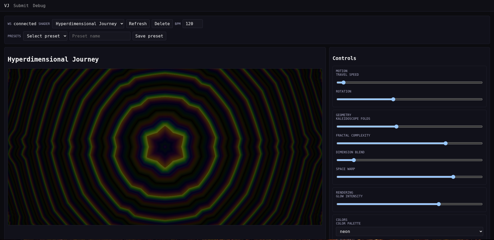

# sh8r



sh8r is a live VideoJockey tool for submitting and performing GLSL shaders.
The app exposes three primary views: Submit, VJ, and Live, plus a Debug view.
The VJ controls shader parameters in real time; all screens receive state via WebSockets.

## Features

- Shader submission (JSON manifest or raw GLSL)
- Dynamic controls based on shader parameter metadata
- Realtime server-authoritative updates via WebSockets
- Preset save/load per shader
- BPM/beat/bar uniforms for timing sync
- Live fullscreen view + optional debug overlay

## Views

- `/live` (also `/`): fullscreen output. Double-click or press `F` for
  fullscreen; the cursor hides when idle and the screen is kept awake.
  URL options: `?debug` (fps, resolution and compile errors overlay),
  `?scale=0.5` (fixed render scale, disables adaptive resolution),
  `?dpr=2` (render above CSS resolution on high-DPI screens),
  `?maxpx=8294400` (raise the default 1920x1080 pixel cap, e.g. for 4K).
- `/vj`: shader selection, generated controls (double-click a label to reset
  it), presets, BPM with tap tempo and downbeat sync. The preview can be
  hidden to save battery on the controlling device.
- `/submit`: manifest or raw GLSL with an in-browser compile check and preview.
- `/debug`: connection, clock sync, renderer stats, uniforms, recent messages.

Clients reconnect automatically after server restarts or network drops.

## Access control

sh8r has no login of its own and no auth flag: the backend accepts every
request. Who may control the show is decided by the reverse proxy in front,
so any login works, or none:

- **No auth** (party on a trusted network): expose it as is. Anyone who can
  open `/vj` can drive the screens.
- **Any proxy login**: protect the control paths below with nginx
  `auth_basic`, Authelia, oauth2-proxy, ... Public:
  `/live`, `/debug`, `GET /api/*` and the `/ws` socket. The socket is
  read-only; it only answers clock pings, so viewers cannot change the show.
  Protected: the `/vj` and `/submit` pages and every non-GET API call. VJ
  commands (param changes, shader/preset selection, tempo) are sent as
  `POST /api/control`, so they carry the browser's login (cached basic auth
  or session cookie). A `401` from the API shows "log in via the VJ page".

Minimal nginx with basic auth (`htpasswd -c /etc/nginx/.htpasswd-sh8r vj`):

```nginx
location ~ ^/(vj|submit) {
    auth_basic "sh8r"; auth_basic_user_file /etc/nginx/.htpasswd-sh8r;
    proxy_pass http://127.0.0.1:8080;
}
location /api/ {
    limit_except GET HEAD OPTIONS {
        auth_basic "sh8r"; auth_basic_user_file /etc/nginx/.htpasswd-sh8r;
    }
    proxy_pass http://127.0.0.1:3001;
}
location /ws {
    proxy_pass http://127.0.0.1:3001;
    proxy_http_version 1.1;
    proxy_set_header Upgrade $http_upgrade;
    proxy_set_header Connection "upgrade";
}
location / { proxy_pass http://127.0.0.1:8080; }
```

On breathdance the same paths sit behind Authelia (sh8r block in the
monorepo's `configs/etc/nginx/sites-available/breathdance.conf`; `auth_request`
cannot sit inside `limit_except`, so an Authelia rule bypasses GET/HEAD/OPTIONS
on `^/api/` instead). Container ports are bound to 127.0.0.1, so the backend
cannot be reached around the proxy.

## Tests

```bash
make test   # runs `npm test` in backend/ and frontend/ (node --test)
```

## Local development

### With Docker Compose

```bash
make setup-dev
make run-dev
```

Services run on:
- Frontend: `http://localhost:${SH8R_FRONTEND_DEV_PORT:-3000}`
- Backend API: `http://localhost:${SH8R_BACKEND_DEV_PORT:-3001}`
- WebSocket: `ws://localhost:${SH8R_BACKEND_DEV_PORT:-3001}/ws`

### Without Docker

```bash
cd backend && npm install && npm run dev
cd ../frontend && npm install && npm run dev
```

## Environment variables (host-level)

All variables are prefixed with `SH8R_` when supplied by the host.

- `SH8R_API_URL` - Frontend API URL (prod build)
- `SH8R_WS_URL` - Frontend WS URL (prod build)
- `SH8R_FRONTEND_PORT` - Frontend prod port (default: 8080)
- `SH8R_FRONTEND_DEV_PORT` - Frontend dev port (default: 3000)
- `SH8R_BACKEND_PORT` - Backend prod port (default: 3001)
- `SH8R_BACKEND_DEV_PORT` - Backend dev port (default: 3001)
- `SH8R_DATABASE_URL` - Backend database URL
- `SH8R_POSTGRES_USER` - Local postgres user (dev profile)
- `SH8R_POSTGRES_PASSWORD` - Local postgres password (dev profile)
- `SH8R_POSTGRES_DB` - Local postgres database (dev profile)
- `SH8R_POSTGRES_PORT` - Local postgres port (dev profile)
- `SH8R_ENVIRONMENT` - Runtime environment label
- `SH8R_LOG_LEVEL` - Backend log level
- `SH8R_DOCKER_NETWORK_NAME` - Docker network name

## Layout

```
backend/   Fastify + WebSocket API
frontend/  React + Vite frontend
```
